<div align="center">

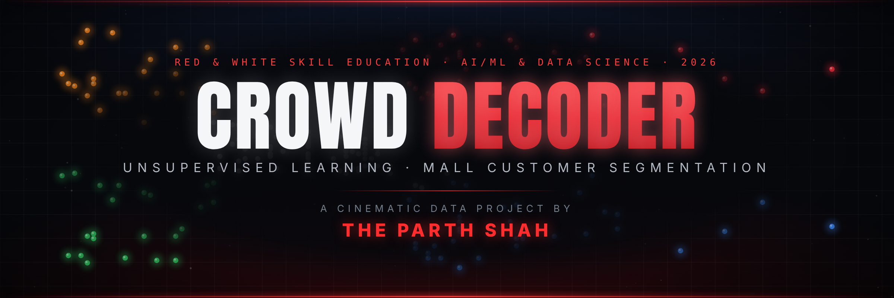

# 🛍️ CROWD DECODER
### _An Unsupervised Learning Odyssey by_ **👑 THE PARTH SHAH**

> "A crowd looks like noise — until you find the patterns it was hiding all along." ✨


[](https://colab.research.google.com/github/ParthShah7099/Crowd_Decoder_Unsupervised_Learning/blob/main/UL_PR1.ipynb)

</div>

---

**TL;DR:** Segments 200 mall customers into 5 groups the marketing team can act on, using three unsupervised algorithms — **K-Means, Agglomerative Hierarchical Clustering and DBSCAN** — then puts them head-to-head on Silhouette, Davies–Bouldin and Calinski–Harabasz scores. K-Means wins (Silhouette **0.555**), Hierarchical agrees on **196 of 200** customers, and DBSCAN exposes **14 outliers**. **Python · pandas · NumPy · Matplotlib · Seaborn · scikit-learn · SciPy.** [→ Notebook](./UL_PR1.ipynb) · [→ HTML version](./UL_PR1.html) · [→ Video walkthrough](#-video--watch-the-walkthrough)

---

## 📚 Navigation

* [🎬 The Story](#-the-story)
* [🧩 The Mission](#-the-mission)
* [🔮 Before You Scroll: How Many Tribes Do You See?](#-before-you-scroll-how-many-tribes-do-you-see)
* [🧠 The Intelligence Inside](#-the-intelligence-inside)
* [📁 The System Architecture](#-the-system-architecture)
* [🛒 The Dataset](#-the-dataset)
* [🔎 First Look — EDA & Scaling](#-first-look--eda--scaling)
* [🎯 Algorithm 1 — K-Means Clustering](#-algorithm-1--k-means-clustering)
* [🌳 Algorithm 2 — Agglomerative Hierarchical Clustering](#-algorithm-2--agglomerative-hierarchical-clustering)
* [🌌 Algorithm 3 — DBSCAN](#-algorithm-3--dbscan)
* [🏆 The Showdown](#-the-showdown)
* [💼 Business Insights for Mall Management](#-business-insights-for-mall-management)
* [🔍 Insights Uncovered](#-insights-uncovered)
* [🎥 Video — Watch the Walkthrough](#-video--watch-the-walkthrough)
* [🧰 Tools Used](#-tools-used)
* [🚀 How to Run](#-how-to-run)
* [✨ The Parth Shah Signature](#-the-parth-shah-signature)
* [🎁 Bonus](#-bonus)
* [📥 Download the Experience](#-download-the-experience)
* [📜 License](#-license)

---

## 🎬 THE STORY

Walk into any mall on a Saturday and you'll see a crowd.

Hundreds of people. Different ages. Different wallets. Different reasons for being there.  
To the security guard, it's just footfall.  
To the marketing team, it's a problem — because one offer sent to everyone is an offer that most people ignore.

I was handed exactly that crowd: **200 real customers**, four columns of quiet evidence — gender, age, annual income, spending score — and not a single label telling me who anyone was.

> *Can an algorithm look at a crowd and find the tribes hidden inside it — without ever being told what to look for?*

That's the whole promise of unsupervised learning. No answer key. No teacher. Just data, distance, and a question.

So I didn't trust one algorithm. I hired three — **K-Means**, **Agglomerative Hierarchical Clustering** and **DBSCAN** — gave them the same customers, and made them argue until the answer stopped changing.

This is **Crowd Decoder** — not a clustering script, but a cross-examination: three very different ways of seeing the same 200 people, compared honestly, and turned into decisions a mall can actually use on Monday morning.

<div align="center">
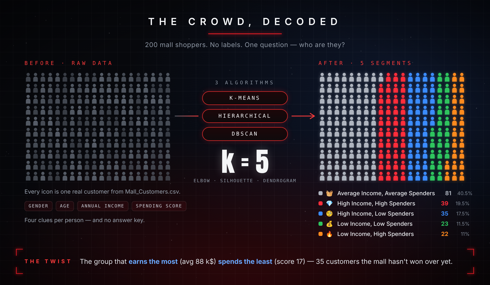
</div>

> Every icon is one real customer from the dataset. Same 200 people on both sides — the right side has just been decoded.

---

## 🧩 THE MISSION

> *"Your goal is to understand WHY each step is performed, not just how to write the code."*
> — the brief, Red & White Skill Education · Unsupervised Learning · PR 1

Seven tasks. Three algorithms. One dataset of 200 shoppers.  
Every k justified twice. Every centroid checked by hand before it was trusted on a plot. Every algorithm scored on the same metrics, on the same customers.  
And at the end of it — five segments, five marketing actions, and one recommendation.

**Mission accomplished. ✅**

---

## 🔮 BEFORE YOU SCROLL: HOW MANY TRIBES DO YOU SEE?

This is the raw data — every dot is one customer, before any algorithm has touched it.

<div align="center">
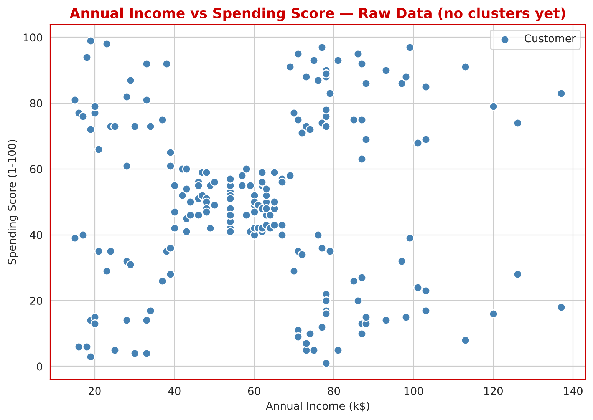
</div>

In unsupervised learning, *you* are the first algorithm. Make your guesses before the machines make theirs.

<details>
<summary><b>🎯 Guess #1 — How many customer groups can you spot?</b></summary>
<br>

A) 3 &nbsp;&nbsp; B) 4 &nbsp;&nbsp; C) 5 &nbsp;&nbsp; D) 6 or more<br>
<br>
Head to <b>Tasks 3 and 4</b>. The Elbow Method, the Silhouette Score and the dendrogram's biggest gap all land on the same answer — and DBSCAN (<b>Task 5</b>) has a very different opinion.
</details>

<details>
<summary><b>🎯 Guess #2 — Do people who earn more, spend more?</b></summary>
<br>

It feels obvious. It isn't. The correlation between income and spending score in this mall is <b>0.01</b> — practically zero. <b>Task 1</b> shows why that tiny number is exactly what makes the four "corner" segments possible.
</details>

<details>
<summary><b>🎯 Guess #3 — Which group is the mall's biggest untapped opportunity?</b></summary>
<br>

Not the big spenders — they're already spending. The answer is in <b>Task 6.3</b>: 35 customers who earn about as much as anyone in the mall… and spend almost nothing.
</details>

---

## 🧠 THE INTELLIGENCE INSIDE

| # | Task | Technique | What It Actually Answers |
|---|---|---|---|
| 1 | Data Loading & EDA | `LabelEncoder`, histograms + KDE, pairplot, correlation heatmap | What do 200 customers look like before any algorithm touches them? |
| 2 | Feature Scaling & Selection | `StandardScaler`, 2-feature subset | Why must income and spending play on the same scale? |
| 3 | K-Means Clustering | Elbow Method, Silhouette Score, `KMeans` | How many segments — and who is in each one? |
| 4 | Agglomerative Hierarchical | Ward `linkage` + `dendrogram`, `AgglomerativeClustering` | Does a completely different method find the same segments? |
| 5 | DBSCAN | 4-NN distance plot, eps × min_samples grid search, `DBSCAN` | What happens when density decides — and who are the outliers? |
| 6 | Comparison & Business Insights | 3-panel figure, Silhouette / Davies–Bouldin / Calinski–Harabasz | Which algorithm wins — and what should the mall actually do? |
| 7 | Notebook Quality | Restart & Run All, HTML export, pinned requirements | Can anyone, anywhere, reproduce every number? |

**Built entirely with:** 🐍 Python · 🐼 pandas · 🔢 NumPy · 📊 Matplotlib · 🎨 Seaborn · 🤖 scikit-learn · 🔬 SciPy · 📓 Google Colab — no shortcuts, no unexplained imports, and every result checked before it was trusted.

---

## 📁 THE SYSTEM ARCHITECTURE

```
Crowd_Decoder_Unsupervised_Learning/
│
├── UL_PR1.ipynb             # The full analysis — all 7 tasks, code, markdown, charts
├── UL_PR1.html              # Same notebook, readable in any browser without Jupyter
├── Mall_Customers.csv       # Kaggle dataset — 200 customers, 5 columns
├── requirements.txt         # Pinned library versions from the final clean run
├── README.md                # You are here
├── LICENSE                  # MIT License
├── CHANGELOG.md             # Version history
├── CONTRIBUTING.md          # How to report bugs or suggest improvements
├── CODE_OF_CONDUCT.md       # Community standards
├── SECURITY.md              # How to report a security concern
├── CITATION.cff             # Powers GitHub's "Cite this repository" button
├── setup.cfg                # Project metadata
├── .gitignore               # Keeps caches, system files and the video out of Git
├── .gitattributes           # Line endings + keeps the HTML export out of the language bar
│
├── images/                  # README graphics + the GitHub social-preview cover
│   ├── banner.png
│   ├── story.png
│   ├── insights.png
│   └── cover.png
│
└── screenshots/
    ├── 01_feature_distributions.png
    ├── 02_pairplot.png
    ├── 03_correlation_heatmap.png
    ├── 04_income_vs_spending_raw.png
    ├── 05_elbow_method.png
    ├── 06_silhouette_scores.png
    ├── 07_kmeans_clusters.png
    ├── 08_dendrogram_ward.png
    ├── 09_hierarchical_clusters.png
    ├── 10_kmeans_vs_hierarchical.png
    ├── 11_knn_distance_plot.png
    ├── 12_dbscan_clusters.png
    ├── 13_three_panel_comparison.png
    └── 14_extension_2_vs_4_features.png
```

---

## 🛒 THE DATASET

**Mall Customer Segmentation Data** — Kaggle · CC0: Public Domain  
🔗 **https://www.kaggle.com/datasets/vjchoudhary7/customer-segmentation-tutorial-in-python**

200 anonymised customer records from a shopping mall. No missing values, no duplicates — so every minute goes into the clustering, not the cleaning.

| Column | Type | What happened to it |
|---|---|---|
| `CustomerID` | Whole number | Dropped — just a serial number, says nothing about behaviour |
| `Gender` | Text | Encoded with `LabelEncoder` → Female = 0, Male = 1 |
| `Age` | Whole number (18–70) | Scaled with `StandardScaler` |
| `Annual Income (k$)` | Number (15–137) | Renamed `Annual_Income`, scaled — **clustering feature** |
| `Spending Score (1-100)` | Whole number (1–99) | Renamed `Spending_Score`, scaled — **clustering feature** |

---

## 🔎 FIRST LOOK — EDA & SCALING

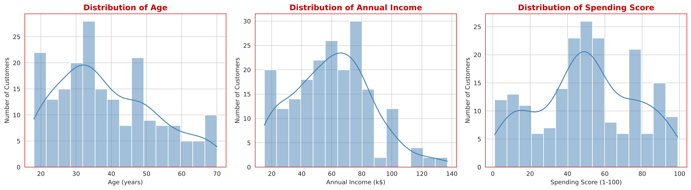
> Age leans young (most shoppers are 20–50). Income sits mostly between 40 and 80 thousand with a thin tail past 100. Spending Score is the interesting one — a tall peak in the middle and separate humps at both ends, the first hint that this crowd is really several crowds.

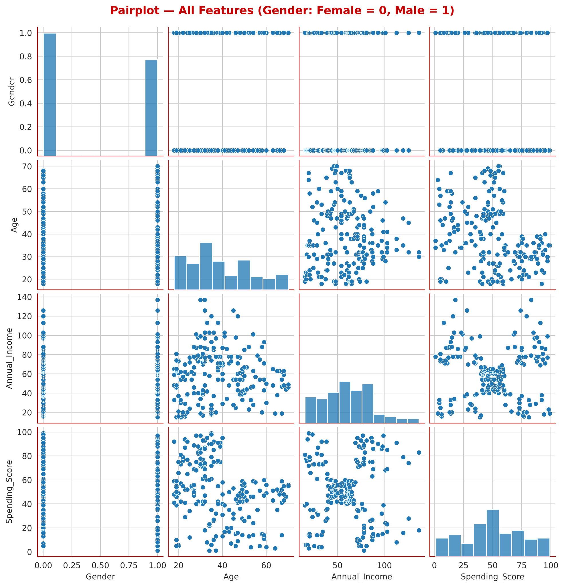
> Every feature against every other feature. Only one panel breaks into clear islands: **Annual Income vs Spending Score** — four corners and one crowded centre.

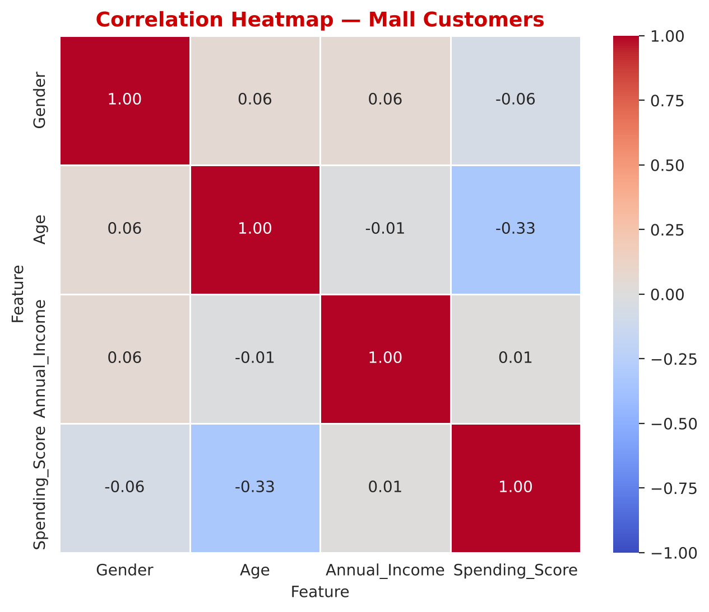
> The strongest link in the whole dataset is Age vs Spending Score at just **−0.33**. Income vs Spending is **0.01** — earning more does *not* mean spending more. That's exactly why these two features make such a powerful pair: each one says something the other can't.

**Why scale at all?** All three algorithms measure *distance*, and a feature with bigger numbers quietly gets a bigger vote. `StandardScaler` turns every feature into **z = (x − mean) / std**, so each one gets an equal say. Honest observation from the notebook: income (std ≈ 26.3) and spending (std ≈ 25.8) happen to be spread almost equally here, so for this pair the effect is small — but the moment Age joins in (std ≈ 14.0), or income is recorded in full rupees instead of thousands, skipping this step would let one feature quietly outvote the others.

---

## 🎯 ALGORITHM 1 — K-MEANS CLUSTERING

**How it works:** choose *k*, drop *k* centroids, give every customer to the nearest centroid, move each centroid to the mean of its customers — repeat until nothing moves. Centroid-based, fast, and built for round, similar-sized groups.

### 📈 The Elbow Method
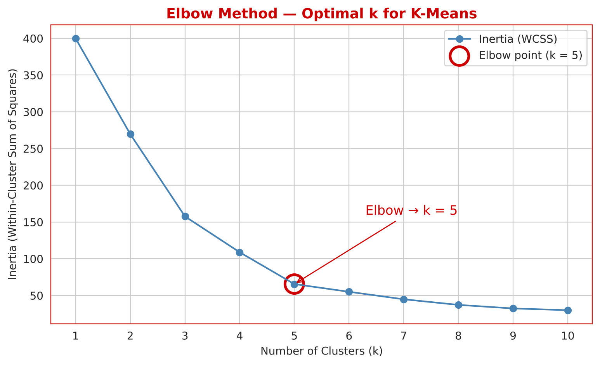
> Inertia drops by **130, 112, 49 and 43** as k goes from 1 to 5 — then the drops collapse to about **10**. That bend is the elbow: **k = 5**.

### 🎯 The Silhouette Score
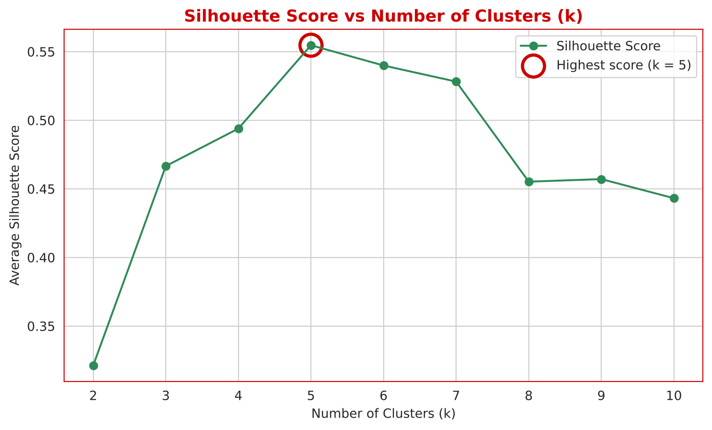
> The data-driven second opinion. Silhouette peaks at **0.555 for k = 5**. The Elbow and the Silhouette agree — no tie-breaker needed.

### 🛍️ The Five Segments
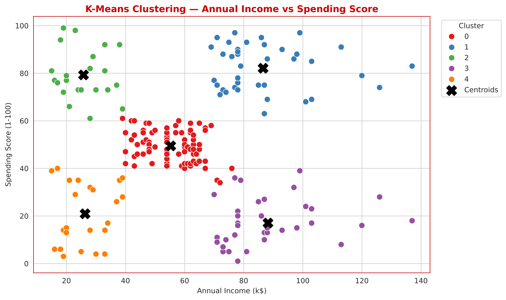
> Five clean segments, each with its centroid (black ✖) sitting right in the middle. One catch that's easy to miss: the model was trained on *scaled* data, so its centroids live in scaled units. Plotted directly on real income and spending, all five ✖ would have landed in the bottom-left corner. The notebook converts them back to real units — and first proves, by hand, that each centroid really is the mean of its cluster.

---

## 🌳 ALGORITHM 2 — AGGLOMERATIVE HIERARCHICAL CLUSTERING

**How it works:** every customer starts alone; the two closest clusters are merged again and again until one giant tree remains. With **Ward linkage**, each merge is the one that increases total within-cluster variance the least. Connectivity-based, deterministic, and its decisions are never undone.

### 🌲 The Dendrogram
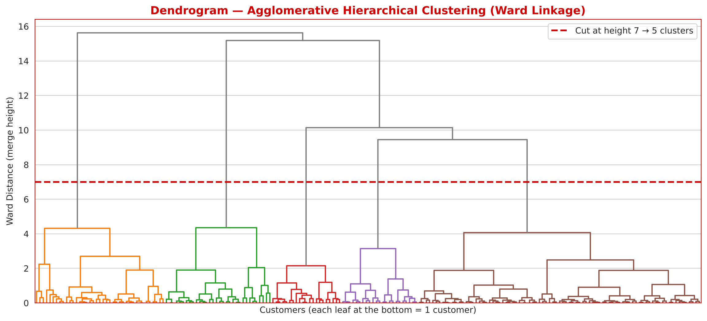
> Read it from the bottom up: short joins = similar customers, tall joins = very different groups being forced together. The biggest jump in merge height is from **4.35 to 9.45** — so the red cut line at **height 7** crosses exactly **5 branches**. A third independent vote for k = 5.

### 🎨 Hierarchical Clusters
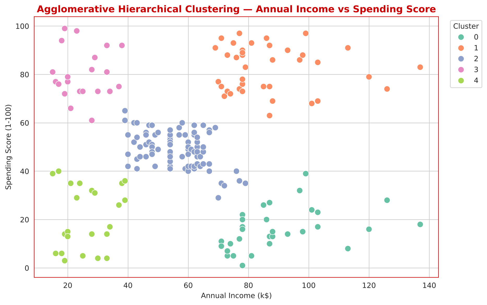
> Same five shapes — discovered by a completely different method.

### ⚖️ K-Means vs Hierarchical
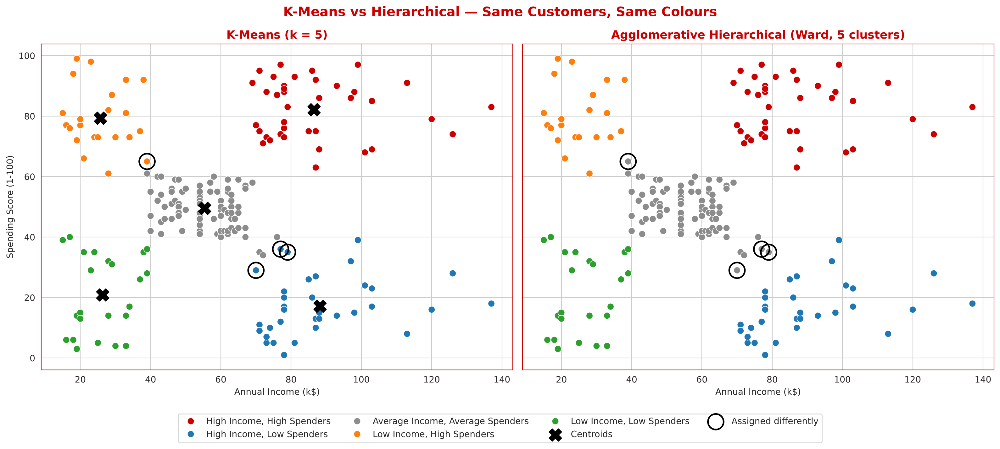
> Same colour = same segment. **196 of 200 customers (98%)** land in the same place. The 4 circled customers sit on the borders: K-Means gave them to a corner group (nearest centroid wins), while Hierarchical had already merged them into the centre group early in the tree — and Hierarchical never un-merges.

---

## 🌌 ALGORITHM 3 — DBSCAN

**How it works:** forget centroids — follow density. A **core point** has at least `min_samples` points (itself included) within radius `eps`; clusters grow outward from core points; anything stranded in a sparse area becomes **noise (−1)**. No k needed, any shape allowed, outliers flagged automatically.

### 📏 Estimating eps — the 4-NN Distance Plot
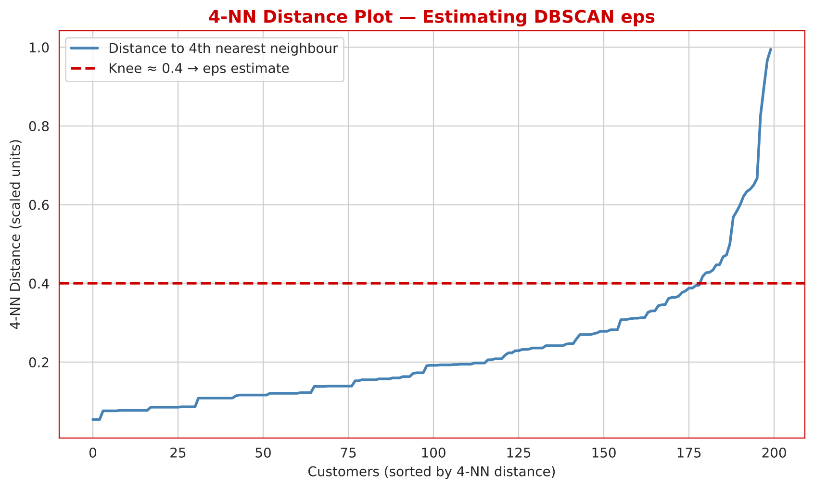
> Sort every customer's distance to their 4th-nearest neighbour and the curve stays flat… until it doesn't. The knee at **≈ 0.4** is the first estimate for eps — and **min_samples = 4** follows the rule of thumb *2 × number of features*.

### 🔬 The Grid Search
20 combinations tested (eps 0.2 → 0.6 × min_samples 3 → 6), each with cluster count, noise count and Silhouette (noise excluded):

| eps | Verdict |
|---|---|
| 0.2 | Too strict — 44 to 95 customers end up as noise |
| 0.3 | Too fragmented — 6 to 9 clusters, several of them tiny |
| **0.4** | **Sweet spot — matches the knee; min_samples = 4 gives 3 clusters with only 14 noise points (7%)** |
| 0.5 – 0.6 | Too loose — everything melts into 1 or 2 clusters |

> One honest catch: Silhouette leaves noise points out, so throwing more hard border points into noise can *raise* the score without the clustering getting any better. The notebook balances Silhouette against noise instead of blindly chasing the highest number.

### 🕵️ DBSCAN Clusters
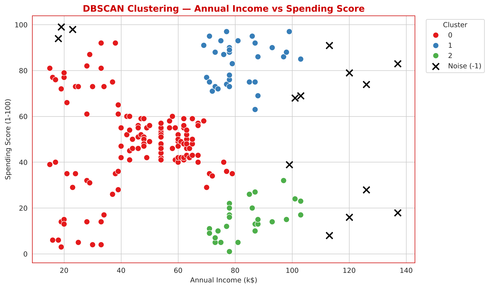
> Density decides: **3 clusters + 14 noise points** (black ✕). The noise is the extreme edge of the crowd — 11 of the 16 customers who earn 99 thousand or more, plus 3 customers earning under 25 thousand with spending scores of 94–99. K-Means had quietly forced these people into groups; DBSCAN refuses to. Meanwhile, the centre group and both low-income groups melt into one 126-customer cluster, because no low-density gap separates them.

---

## 🏆 THE SHOWDOWN

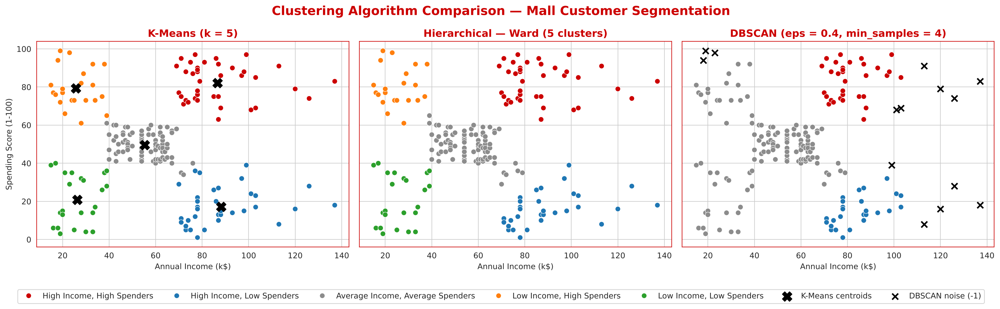
> One canvas, three algorithms — same customers, same axes, same colour for the same segment.

| Algorithm | Clusters | Noise | Silhouette ↑ | Davies–Bouldin ↓ | Calinski–Harabasz ↑ |
|---|---|---|---|---|---|
| 🥇 **K-Means** | 5 | 0 | **0.5547** | **0.5722** | **248.65** |
| 🥈 Hierarchical (Ward) | 5 | 0 | 0.5538 | 0.5779 | 244.41 |
| 🥉 DBSCAN | 3 | 14 | 0.4576 | 0.6546 | 132.04 |

*(DBSCAN scored on non-noise points only. ↑ higher is better, ↓ lower is better.)*

**K-Means wins all three metrics.** Hierarchical is a whisker behind — no surprise, since Ward minimises the same within-cluster variance K-Means does. DBSCAN trails because its giant 126-customer cluster mixes three different spending groups into one.

### 🧪 Extension — 2 Features vs 4
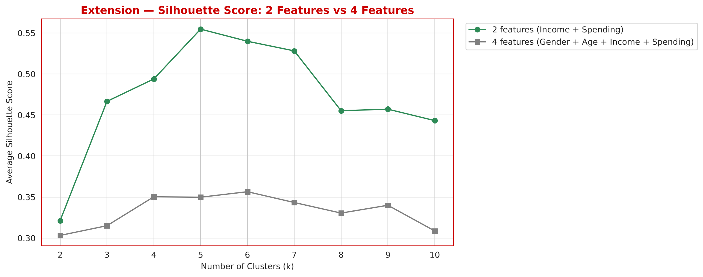
> Adding Age and Gender didn't add insight — it added blur. Best Silhouette: **0.555 with 2 features vs 0.356 with all 4**, and the 4-feature line is lower at every single k. More columns is not more intelligence.

---

## 💼 BUSINESS INSIGHTS FOR MALL MANAGEMENT

| Segment | Customers | Avg Age | Avg Income (thousands) | Avg Spending Score | One Targeted Marketing Action |
|---|---|---|---|---|---|
| 💎 **High Income, High Spenders** | 39 (19.5%) | 32.7 | 86.5 | 82.1 | **VIP loyalty programme** — tiered rewards, early access to new collections, personal shopping |
| 🧐 **High Income, Low Spenders** | 35 (17.5%) | 41.1 | 88.2 | 17.1 | **Quality-and-value campaign** — premium brands, warranties, exclusive experiences + personalised "spend more, save more" vouchers |
| 🧺 **Average Income, Average Spenders** | 81 (40.5%) | 42.7 | 55.3 | 49.5 | **Points card for repeat visits** — monthly offers and festival campaigns that reward regular footfall |
| 🔥 **Low Income, High Spenders** | 22 (11%) | 25.3 | 25.7 | 79.4 | **Trend-led social media promotions** — Instagram campaigns, new-arrival alerts, student discounts |
| 💰 **Low Income, Low Spenders** | 23 (11.5%) | 45.2 | 26.3 | 20.9 | **Budget promotions** — clearance sales, combo packs and discount days |

**🏅 Recommended for deployment: K-Means.** Best scores on all three metrics, the easiest to explain (every segment has an "average customer" the marketing team can picture), and a brand-new shopper can be placed into a segment instantly with `kmeans.predict()`. **Hierarchical** is the pick when management wants a visual hierarchy for a presentation — and its 98% agreement makes it the perfect validator. **DBSCAN** is the pick when cluster shapes are unknown, and as an outlier detector: its 14 noise customers deserve a personal look.

---

## 🔍 INSIGHTS UNCOVERED

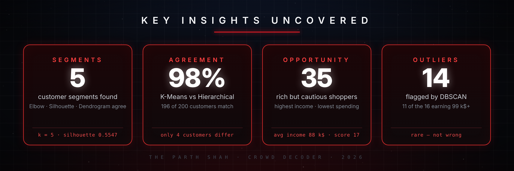

- 📌 **Three methods, one answer:** the Elbow Method, the Silhouette Score and the dendrogram's biggest gap all independently chose **k = 5**.
- 📌 **Earning ≠ spending:** income and spending score have a correlation of just **0.01** — which is exactly why the High-Income-Low-Spender segment exists at all.
- 📌 **98% agreement:** K-Means and Hierarchical place **196 of 200** customers in the same segment. The 4 disagreements are all border customers between the centre group and a corner.
- 📌 **The biggest opportunity is hiding in plain sight:** **35 customers** earn about **88 thousand** on average — as much as the VIPs — but score just **17** on spending.
- 📌 **The youngest segment spends beyond its wallet:** Low Income, High Spenders average **25 years old** and earn about **26 thousand** — yet score **79** on spending.
- 📌 **Outliers are not errors:** DBSCAN's 14 noise points include 11 of the 16 customers who earn 99 thousand or more — rare, not wrong, and worth a personal approach.
- 📌 **Less is more:** 2 well-chosen features (Silhouette 0.555) beat all 4 features (0.356).

---

## 🎥 VIDEO — WATCH THE WALKTHROUGH

<div align="center">

**[▶️ Watch the full video breakdown — face cam + screen, all 7 tasks explained](VIDEO_LINK_HERE)**

*Scaling, the Elbow and the Silhouette, reading a dendrogram, tuning DBSCAN, the showdown, and what it all means for the mall.*

</div>

---

## 🧰 TOOLS USED

| Tool | Used For |
|---|---|
| 🐍 **Python** | The language behind every step |
| 🐼 **pandas** | Loading, renaming, encoding, cluster profiles, comparison tables |
| 🔢 **NumPy** | Distances, sorting, noise counts |
| 📊 **Matplotlib** | Every chart, the dendrogram cut line, the shared legends |
| 🎨 **Seaborn** | Histograms with KDE, pairplot, heatmap, cluster scatter plots, `whitegrid` style |
| 🤖 **scikit-learn** | `LabelEncoder`, `StandardScaler`, `KMeans`, `AgglomerativeClustering`, `DBSCAN`, `NearestNeighbors`, Silhouette / Davies–Bouldin / Calinski–Harabasz |
| 🔬 **SciPy** | Ward `linkage` and the `dendrogram` |
| 📓 **Google Colab / Jupyter** | Running, documenting and exporting the notebook |

### 📦 Requirements

```
pandas==3.0.5
numpy==2.5.3
matplotlib==3.11.2
seaborn==0.13.2
scikit-learn==1.9.1
scipy==1.18.1
jinja2==3.1.6
```

*(`jinja2` is what pandas uses to draw the styled cluster profile table.)*

---

## 🚀 HOW TO RUN

**Option 1 — Google Colab (zero setup)**  
Click [](https://colab.research.google.com/github/ParthShah7099/Crowd_Decoder_Unsupervised_Learning/blob/main/UL_PR1.ipynb) → **Runtime → Run all**. The dataset loads straight from this repository — nothing to upload.

**Option 2 — Run it locally** (Python 3.12 or newer, for the pinned versions)
```bash
git clone https://github.com/ParthShah7099/Crowd_Decoder_Unsupervised_Learning.git
cd Crowd_Decoder_Unsupervised_Learning
pip install -r requirements.txt notebook
jupyter notebook UL_PR1.ipynb
```

**Option 3 — Just read it**  
Open [`UL_PR1.html`](./UL_PR1.html) in any browser — every chart and output is already there.

---

## ✨ THE PARTH SHAH SIGNATURE

Because I don't just run clustering — I cross-examine it.

🎯 Every k justified three times — the Elbow, the Silhouette and the dendrogram.  
🔍 Every centroid checked by hand before it was trusted on a plot.  
⚖️ Every algorithm judged by the same three metrics, on the same 200 customers.  
💼 Every cluster turned into a person — and every person into a plan.

This isn't three algorithms run one after another.  
It's **one question, asked three different ways — until the answer stopped changing.**

---

## 🎁 BONUS

<div align="center">
<pre>
┌──────────────────────────────────────────────────────┐
│  "A segment isn't a label you give people.           │
│   It's a pattern they were already living in."       │
│                                  — THE PARTH SHAH    │
└──────────────────────────────────────────────────────┘
</pre>
</div>

🔎 **Secret for the curious:** scroll to the very end of Task 6.3 in the notebook. A brand-new customer walks in — 30 years old, earning 80 thousand, spending score 22. `kmeans.predict()` doesn't hesitate for a millisecond: **High Income, Low Spenders**. The mall's biggest untapped opportunity just walked through the door — and now the marketing team knows exactly what to say.

---

## 📥 DOWNLOAD THE EXPERIENCE

📓 [UL_PR1.ipynb](./UL_PR1.ipynb) — the full notebook, all 7 tasks  
🌐 [UL_PR1.html](./UL_PR1.html) — the same notebook, readable without Jupyter  
📊 [Mall_Customers.csv](./Mall_Customers.csv) — the 200-customer dataset  
🖼️ [screenshots/](./screenshots) — all 14 key plots  
🧾 [requirements.txt](./requirements.txt) — pinned library versions  
📋 [CHANGELOG.md](./CHANGELOG.md) — version history

---

## 📜 LICENSE

Code and notebook: [MIT License](./LICENSE) © 2026 Parth Shah (THE PARTH SHAH).  
Dataset: [Mall Customer Segmentation Data](https://www.kaggle.com/datasets/vjchoudhary7/customer-segmentation-tutorial-in-python) on Kaggle — CC0: Public Domain.

---

<div align="center">

## 🤝 CONNECT WITH THE CREATOR

💬 _Inspired by this creation?_  
Let's talk data, segments, or exactly why DBSCAN refused to put the richest customers in a cluster.

👉 [**Connect with me on LinkedIn**](https://www.linkedin.com/in/parth-shah-28387532b/) 🔗

---

⭐ **Crafted by THE PARTH SHAH —  
Because even a crowd deserves to be understood.**

</div>
